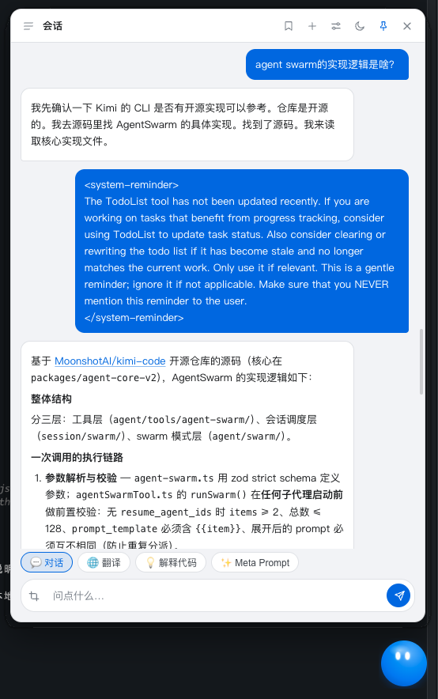
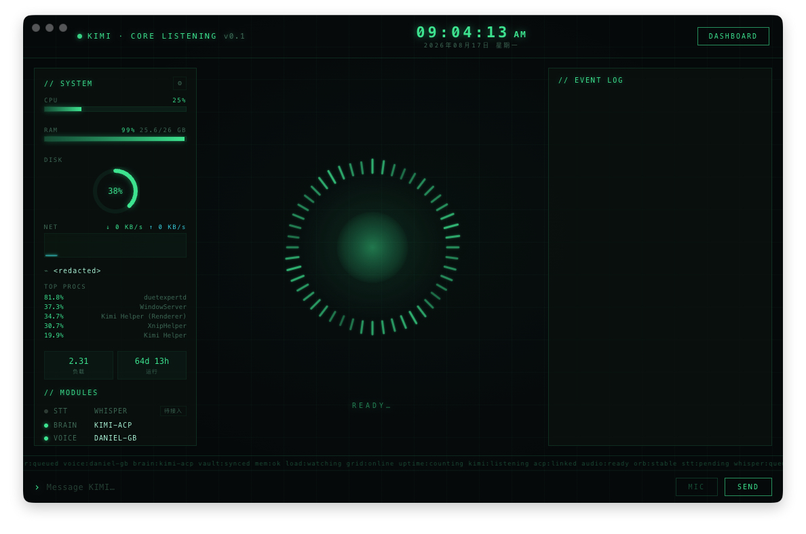
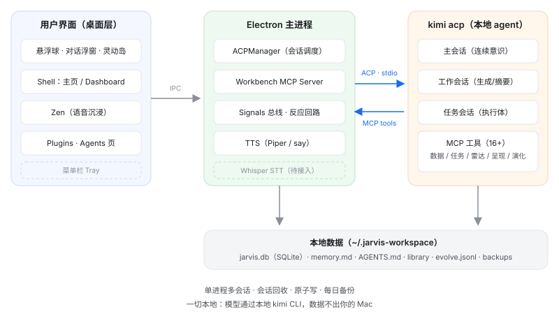
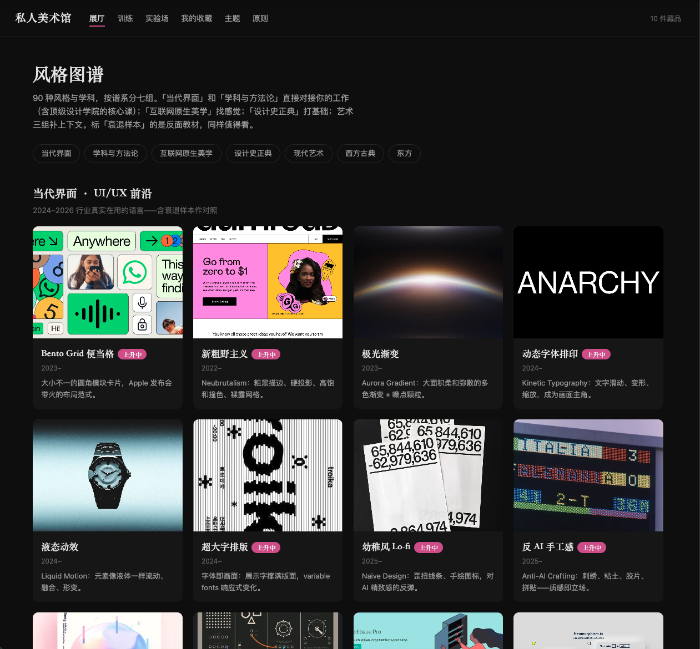

# Kimi Desktop Personal Agent

**一个能自我进化的 Jarvis——常驻你 Mac 的个人智能体。**

voice-first 语音交互 + 可对话自进化的工作台 + System as an Agent。底层通过 **ACP（Agent Client Protocol）** 接入本地 `kimi` CLI，模型能力和工具调用全部由 kimi-code 提供，数据不出你的 Mac。


---

## 这是什么

不是又一个聊天框。它是一个**活着的系统**：

- **它会看**：系统状态、你的任务、雷达情报、甚至你的手机屏幕/摄像头，都是它的感知输入
- **它会做**：你说「建一个追踪 arXiv 的雷达」「给股票看板加个搜索」，它直接改系统，而不是只会给建议
- **它会呈现**：问「今天 AI 新闻」，语音给你摘要的同时，Zen 里浮出一张图文卡片
- **它会进化**：对话就能改组件、改源码、建新 widget——应用层全部可动，改崩了有快照和撤销

## 为谁而建

AI 产品经理、开发者、深度工作人群——想要一个**常驻桌面、随叫随到、越用越懂你**的助手，而不是每次从零开始的对话框。

## 核心能力

### 🔵 悬浮球 & 对话浮窗（桌面入口）

常驻屏幕边缘的蓝色小球：眼睛跟随鼠标、眨眼转头、思考动效，可拖动；点击展开对话浮窗——快速问答、截图提问（`⌘⇧K`）、预设模式（翻译/解释代码/润色/总结，可自定义）、会话管理（新建/恢复/分类）、收藏夹（对 Kimi 说「收藏这个」，自动沉淀为本地 markdown）。这是你日常使用频率最高的入口。




### 🎙 Voice-first 主页与 Zen 模式

系统指标 + 语音 orb + 对话流，以及沉浸式的 Zen 模式—— 渐变光球、四周呼吸光影、TTS 节奏字幕。本地 Piper TTS 或 macOS 声音双引擎，流式播报。




### 🧬 自我进化的工作台

HUD 工作台：任务看板（重复任务/项目分组/一键启动执行）、Deep Focus 番茄钟（含灵动岛倒计时）、Info Radar 情报雷达、Widget Forge 对话生成组件。组件可拖拽、可钉导航、可对话修改——**内置 widget 它都能改自己的源码**。


### 🧠 System as an Agent

系统即 agent：内嵌 MCP Server 把全部能力开放为工具，`system_query` + SQL 数据平面让它**真的知道系统里有什么**——任务、雷达、组件、记忆，随查随答、随说随改。单一能力清单（capabilities.ts）驱动工具注册、Agents 面板和 AGENTS.md 自动更新。

### 🗄 数据平面

所有业务数据在一个 `jarvis.db`（SQLite）：`data_schema` 看结构、`data_query` 用 SQL 查一切、`data_exec` 带护栏修改。纯文本记忆（`memory.md` + `AGENTS.md`）让上下文可编辑、可追溯。

## 系统架构



单进程多会话：一个 `kimi acp` 子进程通过 stdio JSON-RPC 收发，主会话（连续意识）/ 工作会话（生成摘要）/ 任务会话（执行体）分层调度，会话自动回收。

## 用它做了什么？

真实使用场景：

1. **私人美术馆**（后续也会计划开源）




2. **异步分析开源项目代码**


3. **随身助手：解释原理、问个单词**


## 快速开始

```bash
# 前提：macOS（Apple Silicon）、已安装并登录 kimi CLI（kimi acp，>= 0.31）
npm install
npm start        # 构建并启动
npm run watch    # 开发模式（tsc + esbuild watch）
```

首次使用：

- 启动即进入 Shell 主页；`⌘⇧J` 全局唤起，`⌘⇧K` 截图问答，菜单栏 Tray 常驻
- 在设置里选择工作文件夹（默认 `~/KimiWorkspace`）
- 首次截图/录屏需授予 macOS「屏幕录制」权限，语音交互需「麦克风」权限（STT 接入后）

## 配置

运行期数据都在本机，不进仓库：

| 位置 | 内容 |
| --- | --- |
| `~/Library/Application Support/Kimi Desktop Personal Agent/` | settings.json（声音/权限/thinking）、modes.json、tts 模型 |
| `~/.jarvis-workspace/` | jarvis.db（任务/雷达/组件）、memory.md、agents.md、layout、backups（每日滚动，保留 7 天） |
| `~/KimiWorkspace/AGENTS.md` | 工作区约定 + 能力清单（自动生成） |

## Roadmap

- [x] v0.1 悬浮球 + 对话窗 + ACP
- [x] v0.2 Jarvis 工作台 + Voice-first 主页 + 自进化引擎
- [x] v0.3 任务系统（重复任务/项目/一键启动）+ Tray
- [x] v0.4 Jarvis Shell + System as an Agent + 数据平面 + 呈现层
- [ ] Whisper 语音输入（STT）
- [ ] 快慢模型分层（日常问答 / 深度工作）
- [ ] 手机端联动
- [ ] Proactive agent（基于 Signals 的主动建议）

## License

MIT
