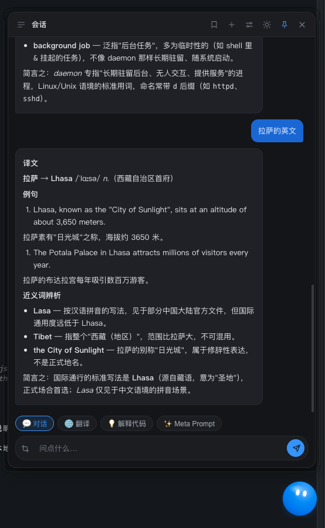
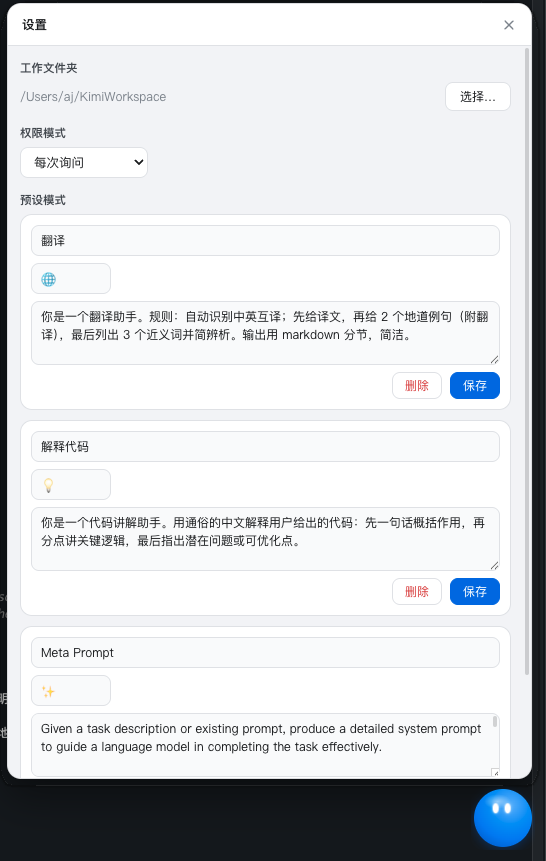

# kimi-float

一个常驻 macOS 桌面的 Kimi 悬浮助手：蓝色小球常驻屏幕边缘，点一下就能问问题、发截图、收藏灵感。后端通过 **ACP（Agent Client Protocol）** 接入你本地的 `kimi` CLI，模型能力和工具调用全部由 kimi-code 提供。


## 设计目标

- **Always-on**：不打断当前工作流，全局快捷键随叫随到
- **轻入口重后端**：UI 只做交互，对话、工具、会话持久化全部交给 `kimi acp`，本地不重复实现 agent 逻辑
- **灵感有处可去**：对 Kimi 说一句「收藏这个」，内容自动沉淀为本地 markdown，可修改、可追溯

<!-- 截图占位：悬浮球 / 对话窗 / 暗色模式 -->





## 用它做了什么？
1. 私人美术馆
> 后续也会计划开源


2. 异步分析开源项目代码

3. 随身助手：解释原理、问个单词...

More..

## 架构


单进程多会话：一个 `kimi acp` 子进程通过 stdio 收发 JSON-RPC，所有会话挂在它上面；对话历史由 kimi 自己持久化，客户端只存索引。

## 功能

| 功能 | 说明 |
| --- | --- |
| 悬浮球 | 眼睛跟随鼠标、眨眼/转头空闲动画、思考/输出动效，可拖动 |
| 对话窗 | 流式渲染、markdown（表格/代码/链接）、思考过程折叠框、工具状态单行滚动 |
| 截图问答 | `⌘⇧K` 全局唤起 + 区域截图；也支持直接 `⌘V` 粘贴图片 |
| 预设模式(meta prompt) | 翻译 / 解释代码 / 润色 / 总结，本质是「system prompt 模板 + 用户输入」，设置里可增删改 |
| 收藏夹 | Kimi 按约定把内容写进 `工作文件夹/vault/` 的 markdown，面板内查看、编辑 |
| 会话管理 | 新建 / 恢复历史会话（`session/list` + `session/load`） |
| 消息队列 | 回复中可继续输入，消息排队挂在输入框上方，回合结束自动续发 |
| 停止 | 流式期间发送键变停止键，走 `session/cancel` |
| 交互细节 | 消息右键复制 / 选中引用提问、链接系统浏览器打开、置顶 pin、暗色主题（月之暗面） |

## 原理要点

- **ACP 接入**：`initialize` → `authenticate(login)` → `session/new`；prompt 以 content block 发送（文本 + base64 图片），回复经 `session/update` 流式推送（正文 chunk / 思考 chunk / 工具调用）
- **权限**：kimi 的每次工具调用通过 `session/request_permission` 反向 RPC 询问客户端，悬浮窗弹确认条（允许 / 本会话允许 / 拒绝），也可在设置里切自动模式
- **文件安全**：`fs/read_text_file` / `fs/write_text_file` 反向 RPC 在主进程做了路径沙箱，只允许工作文件夹之内
- **收藏夹约定**：首次启动在工作文件夹写入 `AGENTS.md`，声明 vault 目录的记录规范，kimi 启动时自动读取遵守

## 快速开始

```bash
# 前提：macOS，已安装并登录 kimi CLI（kimi acp，>= 0.31）
npm install
npm start        # 构建并启动
npm run watch    # 开发模式
```

首次使用在设置里选择工作文件夹（默认 `~/KimiWorkspace`）；首次截图需授予 macOS「屏幕录制」权限。

## 配置

运行期配置都存放在系统用户目录（`~/Library/Application Support/kimi-float/`），不进入仓库：

- `settings.json` — 工作文件夹、vault 目录、权限模式
- `modes.json` — 预设模式的自定义与删除记录

## TODO
- 跨session管理
- multi-agent项目管理
- 与手机关联，直接在移动设备操控本地电脑
- 加上搜索引擎
- 个人工作台看板
- 全双工实时语音对话
..more

## License

MIT
